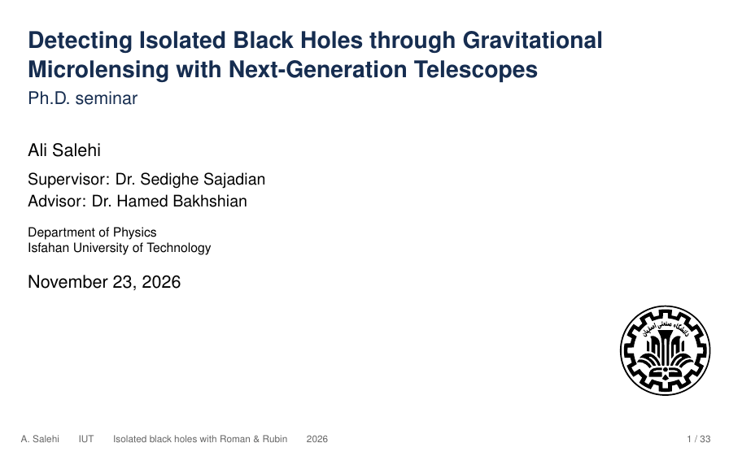

# Ph.D. seminar on isolated black holes with Roman and Rubin

A 30-minute seminar at Isfahan University of Technology, *Detecting Isolated Black Holes through
Gravitational Microlensing with Next-Generation Telescopes*. Supervisor Dr. Sedighe Sajadian,
advisor Dr. Hamed Bakhshian. The slides use the [Beamer theme by Johannes Dorfner](https://github.com/ojdo/thesis-defense).

The seminar presents the first overview report. Its preliminary results come from the
September 24–25, 2026 simulations and the subsequent extinction analysis. The talk closes
with one slide on the next steps in the thesis.

## Preview



## Build and present

Install `latexmk` and a TeX distribution with pdfLaTeX, Beamer, TikZ/PGFPlots, and `animate`.

```bash
git clone --branch phd-seminar https://github.com/iamalisalehi/thesis-defense.git phd-seminar
cd phd-seminar
latexmk -pdf seminar.tex
```

Open `seminar.pdf`. Main slides are in [`tex/00_overview.tex`](tex/00_overview.tex) through
[`tex/07_closing.tex`](tex/07_closing.tex). The backup slides start after the closing slide.
In Beamer, each reveal occupies a separate PDF page and keeps the same slide number.

| Elapsed | Main topic |
| --- | --- |
| 0–3 min | Motivation and research question |
| 3–11 min | Microlensing and the Hubble case |
| 11–14 min | Roman and Rubin |
| 14–19 min | Simulation, precision forecast and example event |
| 19–27 min | September results and limitations |
| 27–30 min | Thesis next steps and summary |

Speaker notes add detail to the main results and worked examples. To print them or show them on a
second screen, see the Beamer options near the top of `seminar.tex`. Use the Hubble, Roman, Rubin
and Milky Way photo slides as short transitions within the same 30 minutes.

Slide 8 animates the off-axis event used in the theory slides. The approximately 6.5-second loop
starts automatically in a PDF viewer that supports `animate`, such as Acrobat Reader or Okular.
Viewers without animation support show a poster at closest approach alongside both complete curves.

## Reuse the presentation features

- **Inline PDF animation.** The off-axis microlensing slide synchronizes the sky geometry, total
  magnification, and centroid shift. Copy the example below into a Beamer frame and replace the
  file stem with your own multipage PDF. The last two arguments select the frame range. Leaving
  both empty plays every page. `poster=32` displays the 33rd animation frame as the static image.
  The same package can play numbered image files by taking a filename prefix and frame numbers.
  [CTAN `animate` documentation](https://ctan.org/pkg/animate)
- **Photo transitions.** `\fullframegraphic` in [`beamerthemeJD.sty`](beamerthemeJD.sty)
  supports full-slide images with captions. The seminar also includes custom full-bleed section
  openers with separate credit overlays in [`tex/03_surveys.tex`](tex/03_surveys.tex).
- **Speaker notes and appendix.** Add `\note{...}` inside frames and choose a notes mode in
  [`seminar.tex`](seminar.tex). Put backup frames after `\appendix` to keep their numbering
  separate from the talk.

```latex
% In the preamble:
\usepackage{animate}

% Inside a frame:
\animategraphics[autoplay,loop,controls=none,poster=32,width=.94\linewidth]{10}%
  {img/sim/point_lens_animation}{}{}
```

Set the poster index to a frame your animation contains. The `10` is the playback rate in frames
per second. The GIF above is a browser preview. The PDF plays the animation in the slide.

## Scientific source trail

The Roman–Rubin project paths below identify the historical outputs used to audit the numbers and
labels. The effective sample sizes quoted for dust-adjusted Rubin fractions describe the underlying
sample before the dust adjustment.

| Slide content | Source |
| --- | --- |
| Main results and modelling assumptions | `Report/overview/overview_report.tex`, `Proposal/sections/06_preliminary.tex` |
| Dust-adjusted yields, fractions and uncertainty | `figures/u1_20260929/u5_corrected_numbers.md` |
| As-simulated fractions, selections and effective sample sizes | `figures/u1_20260929/u1_numbers.md` |
| Paired Earth/L2 forecast and Roman gap comparison | First overview, sections on satellite parallax and gap filling |
| Example black-hole light curves and centroid tracks | First overview sample gallery, `both_011` and `bh_short_b002` |
| Thesis next steps | `Proposal/sections/10_plan.tex` |
| Hubble case study | [Sahu et al. 2022](https://ui.adsabs.harvard.edu/abs/2022ApJ...933...83S), [Lam & Lu 2023](https://arxiv.org/abs/2308.03302), [Sahu et al. 2025](https://arxiv.org/abs/2503.07820) |

The first overview's absolute yields use the per-resolved-object convention and Roman's
1.47-square-degree model footprint. The adopted survey covers about 1.7 square degrees. The
dust-adjusted values reweight detection and precision outcomes after simulation. The detection table
on slide 27 compares black holes, neutron stars, and ordinary lenses over the same Roman footprint
and ten-year window. Each compact-object yield scales with its population’s assumed stellar-mass
fraction. The Einstein-radius and
parallax precision bars use available Roman forecasts for each parameter before the dust adjustment.
The Roman-only and joint mass counts are total footprint yields at the same abundance after the
adjustment.

## Generated figures

```bash
python art/point_lens_curves.py      # analytic curves for the off-axis point lens
python art/point_lens_animation.py # animated geometry and observables for the same event
python art/lensing_animation.py     # reverse ray tracing of a finite-source central transit
python art/microlensing_well.py      # alternate closing art
python art/microlensing_cartoon.py   # alternate face-on art
```

The figure scripts use NumPy and Matplotlib. The ray-traced illustrations also use SciPy and Pillow.
References and image credits are linked from their slides. The inherited license is
[CC BY-SA 4.0](LICENSE). See individual credits for third-party photos and figures.
